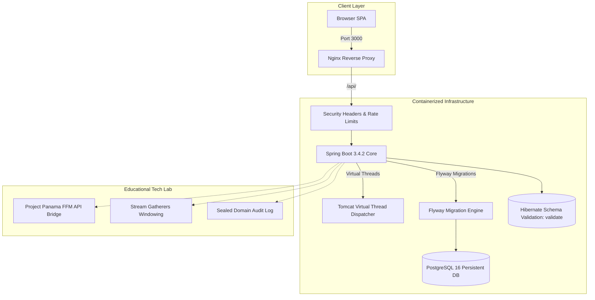

# AI-Assisted Architecture: From Unsupervised "Vibe Coding" to Senior Engineering Governance

> **A case study in modern software engineering:** What happens when an AI agent authors an entire application unsupervised, why green tests and 97% code coverage mask catastrophic architectural failures, and how a Senior Engineer takes control to enforce domain integrity, operational reliability, and pragmatic language modernization.

---

## Executive Summary

This repository documents the evolution of a web application across two fundamentally different paradigms of AI-assisted software development:

1. **Phase 1 — The "Vibe Coding" Experiment (November 2025):** An autonomous AI agent was given free rein to generate a school management CRUD application with zero human intervention. Prompts were supplied; whatever code returned was committed as-is. The resulting code compiled, passed integration tests, achieved 97% line coverage, and ran smoothly on `localhost`. Yet, beneath the surface, the domain model was collapsed, the database was ephemeral and insecure, error handling was nonexistent, and the tests were a closed-loop confirmation bias engine.
2. **Phase 2 — Senior Architectural Governance & The Economics of Modernization (October 2026):** A Senior Engineer intervened to transform the codebase from a fragile toy demo into an enterprise-grade, hardened architecture. Beyond fixing operational foundations (**PostgreSQL 16**, **Flyway**, non-root Docker, centralized error handling), this phase tackles a major historical bottleneck in software engineering: **the cost of library and runtime upgrades**. Instead of a passive "version bump" that only changes numbers in `pom.xml` while leaving code frozen in legacy idioms, we used the AI as a high-leverage refactoring engine to **actively exploit new platform capabilities** (Java Records, Pattern Matching, Sealed Events, Virtual Threads). Crucially, bleeding-edge experimental APIs (Project Panama FFM, Stream Gatherers) were quarantined into an isolated **Educational Technology Lab**, establishing clear architectural boundaries between business domain logic and systems experimentation.

---

## System Architecture: Then vs. Now

| Dimension | Phase 1: Unsupervised "Vibe Coding" | Phase 2: Senior Architectural Governance |
|---|---|---|
| **Architectural Posture** | Naive CRUD; logic pushed to the browser | Layered Domain Architecture; server-side enforcement |
| **Upgrade Strategy** | Stagnant baseline | **Active Modernization:** Refactored to leverage new platform capabilities |
| **Java Platform** | Java 17 (standard boilerplate JavaBeans) | Modern Java with Records, Pattern Matching & Sealed Hierarchies |
| **Concurrency Model** | Platform Threads (OS-bound thread pool) | Virtual Threads (Project Loom) for high-throughput HTTP |
| **Database & Persistence** | In-memory H2, `ddl-auto=update` (ephemeral) | PostgreSQL 16, persistent volumes, Hibernate `ddl-auto=validate` |
| **Schema Evolution** | None (Hibernate auto-generation) | Automated, versioned migrations via **Flyway** (`V1__init_schema.sql`) |
| **Exception Handling** | None; unhandled 500s & raw `ClassCastException` | Centralized `@RestControllerAdvice` with RFC 7807 compliant error contracts |
| **Security & Operations** | Root Docker container; exposed H2 console | Non-root `appuser`; Nginx reverse proxy with security headers |
| **Frontend Architecture** | Monolithic CRA views; silent `console.error` catches | Custom hooks (`usePersons`, `useCourses`), race condition guards, i18n, Toast alerts |
| **Language Lab** | N/A | Dedicated Educational Sandbox for FFM API (Project Panama) & Gatherers |

---

## Quickstart

Run the full production-grade multi-container stack with a single command:

```bash
docker compose up --build
```

### Services & Entrypoints

| Service | Address | Description |
|---|---|---|
| **Web UI** | `http://localhost:3000` | React 18 SPA served via Nginx reverse proxy with security headers |
| **API Gateway** | `http://localhost:3000/api` | Reverse-proxied to Spring Boot (injects `X-Frame-Options`, `X-Content-Type-Options`) |
| **Backend API** | `http://localhost:8080/api` | Spring Boot 3.4.2 REST API with Virtual Threads & Flyway |
| **PostgreSQL 16** | `localhost:5432` | Relational database (`persondb`) with persistent volume `postgres_data` |

*Healthcheck dependencies guarantee PostgreSQL is fully accepting connections (`pg_isready`) before Spring Boot starts Flyway migrations, and Spring Boot is verified healthy before Nginx serves user traffic.*

---

# Act I: The Baseline Experiment (The "Vibe Coding" Trap)

### The Rules of the Experiment
The original experiment was conducted in a single session on 2025-11-27 with one rigid rule: **I would write prompts and nothing else.**
No editing code by hand. No fixing variable names. No nudging configuration files into place. If something was wrong, I asked for a change and accepted whatever the agent generated. The initial commit was `All created by prompt`.

### The Mirage: What Looked Good on the Surface
On paper, the initial output was remarkably competent:
- **Clean layering:** Strict Controller → Service → Repository layout with constructor injection and DTO boundaries.
- **Real integration tests:** Spring Boot `@SpringBootTest` suites executing real HTTP lifecycles (Create → Read → Update → Delete) with JSON assertions.
- **97% Line Coverage:** Reported by JaCoCo.
- **Zero setup friction:** It compiled and launched cleanly from a fresh checkout.

If submitted as an ordinary Pull Request, many teams would have stamped it with an immediate approval.

### The Reality: What Broke Behind the Green Tests
The failure was not in syntax or style; **the failure was entirely in the architectural layer above the code:**

1. **The domain model collapsed the distinction it was supposed to make:**
   `Person` used single-table inheritance with a discriminator column. `Student` and `Teacher` were subclasses with zero fields and zero unique behaviors. There was no `/api/students` and no `/api/teachers`—only `/api/persons`. The React frontend was forced to download the entire database and filter by `personType` in JavaScript, doing the job the API should have done.
2. **The update endpoint silently lied:**
   `PUT /api/persons/{id}` accepted a `personType` in the payload, returned `200 OK`, and silently discarded it. The service only copied `firstName`, `lastName`, and `email`. If an administrator attempted to change a student into a teacher, the API claimed success while mutating nothing.
3. **Unchecked downcasts generated unhandled 500 errors:**
   The codebase contained bare `(Teacher) person` casts without type safety in both `CourseService` and `CourseController`. Assigning a student ID as a teacher produced a raw `ClassCastException` and an HTTP 500 stack trace leak. There was no `@ControllerAdvice` anywhere.
4. **The coverage metric was a vanity illusion:**
   97% line coverage masked that **50% of execution branches were completely untested**—and all untested branches sat precisely in the methods performing unsafe downcasts. `Student` and `Teacher` reported 100% coverage, yet not a single test asserted that creating a student actually produced a student entity. The tests were generated from the code rather than the domain requirements, encoding existing bugs as expected behavior.
5. **AI alucinating software that did not exist:**
   Comments stated that the production profile disabled the H2 console, yet the configuration did the exact opposite. Another comment read `// keep existing 4-arg constructor for compatibility` in a greenfield repository with one commit and zero callers—dead code justified by an invented history.
6. **Docker worked entirely by accident:**
   `frontend/Dockerfile` placed `ARG REACT_APP_API_URL` before the first `FROM`, causing Docker to discard the build argument. It fell back to a hardcoded string `http://localhost:8080/api`. Had the argument worked, a Docker-internal container hostname would have been baked into client-side browser bundles, completely breaking networking.

### Core Takeaway from Act I
> **An AI agent that writes both the implementation and its tests creates a closed-loop confirmation bias engine.**
> Coverage measures how much code was executed, not whether the code satisfies business requirements. High coverage over the wrong abstraction only produces unearned confidence in broken software.

---

# Act II: The Senior Intervention (Architectural & Production Governance)

In Phase 2, the human engineer took the helm—not by rewriting every line manually, but by acting as an **Architectural Governor**: defining strict system constraints, enforcing domain boundaries, and rejecting superficial LLM suggestions.



### 1. Enterprise Persistence & Database Evolution
- **PostgreSQL 16 Multi-Container Stack:** Replaced ephemeral in-memory H2 with production-grade `postgres:16-alpine` backed by a persistent Docker named volume (`postgres_data`).
- **Versioned Migrations with Flyway:** Database schema evolution is now strictly managed via versioned migration scripts (`src/main/resources/db/migration/V1__init_schema.sql`).
- **Strict Hibernate Validation:** Switched Hibernate from destructive auto-updates to `spring.jpa.hibernate.ddl-auto=validate`. Hibernate verifies schema compatibility against Flyway at startup without altering database tables.
- **Database Startup Orchestration:** Docker Compose coordinates container dependencies through explicit healthchecks (`pg_isready -U postgres`), preventing Spring Boot from crashing during cold boots.

### 2. Resilience, Error Boundaries & Query Optimization
- **Centralized `@RestControllerAdvice`:** Introduced `GlobalExceptionHandler` with typed handlers:
  - `IllegalArgumentException` → 400 Bad Request
  - `MethodArgumentNotValidException` → 400 Bad Request with field-level constraint violation details
  - `DataIntegrityViolationException` → 409 Conflict (handling unique email and foreign key violations gracefully)
  - `Exception` → 500 Internal Server Error with sanitized error messages to prevent stack trace leaks
- **N+1 Query Elimination:** In `CourseService`, sequential single-entity lookups in loops were replaced by batch fetching via `personRepository.findAllById(ids)` and in-memory hash indexing, reducing database roundtrips from $O(N)$ to $O(1)$.
- **Database-Level Filtering & Semantic Endpoints:** Introduced dedicated `/api/teachers` and `/api/students` REST controllers, ending the anti-pattern of single-table client filtering and enforcing domain boundaries at the API gateway.
- **Paging & Resource Bounds:** Added Spring Data `Pageable` pagination across all collection endpoints (`?page=0&size=20`) to prevent unbounded memory spikes.

### 3. Container Hardening & Operational Security
- **Multi-Stage Non-Root Docker Build:** Refactored `Dockerfile` into a multi-stage builder creating an unprivileged system user (`USER appuser`), mitigating container breakout vulnerabilities.
- **Reverse Proxy Architecture:** Configured Nginx (`default.conf`) to serve static React artifacts while reverse-proxying `/api/` traffic to the backend container.
- **Perimeter Defense:** Restricted direct host backend binding to `127.0.0.1:8080`, routing external traffic through Nginx to enforce security headers:
  - `X-Frame-Options: SAMEORIGIN` (Clickjacking mitigation)
  - `X-Content-Type-Options: nosniff` (MIME-sniffing protection)
  - `Referrer-Policy: strict-origin-when-cross-origin`
  - `X-XSS-Protection: 1; mode=block`
- **Environment Profile Isolation:** Annotated `DataInitializer` with `@Profile("!prod")` to ensure test seeders never execute in production PostgreSQL environments.
- **Docker Build-Arg Scope Fix:** Relocated `ARG REACT_APP_API_URL` below the `FROM node:18-alpine` line, ensuring build parameters properly inject into the Webpack/React production bundle.

### 4. Frontend Engineering Discipline
- **Modular Component Hierarchy:** Decomposed monolithic views into focused, reusable components (`CourseFormModal`, `CourseViewModal`, `PersonFormModal`, `PersonViewModal`).
- **Direct Domain Ingestion:** Updated `useCourses` and `usePersons` to consume `/api/teachers` and `/api/students` directly, completely eliminating client-side entity filtering.
- **Custom Hook Separation:** Extracted data fetching, caching, and state transitions into dedicated hooks (`usePersons`, `useCourses`).
- **Asynchronous Race Condition Defense:** Implemented sequence request tracking via `useRef(latestRequestIdRef)` in `usePersons`. Rapid typing in search inputs automatically discards stale out-of-order network responses.
- **Internationalization (i18n):** Built dynamic localization (`I18nProvider`) supporting English, Spanish, and French with automatic browser locale negotiation and local storage persistence.
- **Interactive User Feedback (`ToastContext`):** Replaced silent `.catch(console.error)` swallowed promises and raw `[object Object]` alert strings with an interactive, multi-severity Toast notification system.

---

# Act III: The Economics of Upgrades — From Passive Version Bumps to Active AI Modernization

### The Historical Friction: The "Passive Version Bump" Trap

In traditional enterprise software engineering, upgrading dependencies, runtimes, or major frameworks (such as moving from Java 8/11 to Java 17/21, Spring Boot 2.x to 3.x, or React 16 to 18) has historically been treated as a **painful, defensive, and high-risk chore**.

The standard industry operating procedure was minimal:
1. Change the version string in `pom.xml` or `package.json`.
2. Fix whatever compiler errors or breaking API changes immediately broke the build.
3. Suppress deprecation warnings with `@SuppressWarnings("deprecation")`.
4. Merge the Pull Request and pray that nothing regresses in production.

**The result was a profound waste of engineering capital:**
Teams paid the friction, regression testing risk, and deployment overhead of a major migration, yet **the codebase remained mentally frozen in the past**. 
- The project ran on Java 21, but the code was still written as if it were Java 8: bloated JavaBeans with mutable setters, defensive `if (x != null)` cascades, manual thread-pool tuning, and brittle downcasts.
- The project ran on React 18, but components were still monolithic blobs with legacy lifecycle habits.

Why did this happen? **Because the cost of deep, idiomatic refactoring was economically prohibitive.** Manually rewriting hundreds of DTOs into immutable Records, replacing type checks with pattern matching, and redesigning concurrency models around Virtual Threads would take weeks of senior developer time. In real-world companies, product managers and business stakeholders almost never approve multi-sprint refactoring efforts that offer "no visible new features." 

Consequently, software stayed architecturally obsolete even when running on modern runtimes.

---

### The Paradigm Shift: Active Modernization Powered by AI

When a Senior Engineer directs an AI agent, **the economic cost curve of refactoring collapses**. 

A task that previously took 40 hours of tedious manual typing and search-and-replace can now be executed and verified in minutes under strict architectural supervision. This enables a fundamental shift in technical strategy:

> **The goal is no longer just using a newer library version. The goal is having a genuinely more modern, resilient product.**
> 
> Anyone can bump a version in Maven. A Senior leveraging AI exploits the platform upgrade to eliminate boilerplate, eradicate entire classes of runtime bugs, and unlock higher operational throughput.

```
Traditional Upgrade Workflow:
[Bump Version in pom.xml] ──> [Fix Compiler Errors] ──> [Stop / Ship]
                                                           │
                                                           └──> Same old code, higher maintenance debt.

AI-Governed Modernization Workflow:
[Bump Version] ──> [Prompt Architectural Refactoring] ──> [Adopt Platform Primitives] ──> [Senior Review]
                          │                                      │
                          ├──> JavaBeans ➔ Records               ├──> Thread Pools ➔ Virtual Threads
                          └──> Downcasts ➔ Pattern Matching       └──> Monoliths ➔ Modular Hooks
```

### The ROI Comparison Matrix

| Dimension | The Traditional "Passive Version Bump" | AI-Governed Active Modernization |
|---|---|---|
| **Primary Motivation** | Compliance, security CVE patches, forced end-of-life | **Product & Architectural Transformation** |
| **Refactoring Depth** | Surface-level (patch only breaking compiler errors) | Structural & idiomatic across all layers |
| **Data Transfer Objects** | Retains mutable classes with 60+ lines of getters/setters | Compact immutable **Java Records** with contract validation |
| **Type Safety & Branching** | Imperative `instanceof` with dangerous downcasts | Compiler-exhaustive **Pattern Matching for switch** |
| **Concurrency & Throughput** | Heavy OS platform threads; complex thread-pool tuning | Non-blocking **Virtual Threads** across all HTTP handlers |
| **Developer Ergonomics** | Verbose, legacy syntax; high cognitive load | Clean, declarative, expressive code; zero boilerplate |
| **Business Value** | **Pure maintenance cost** (zero architectural dividend) | **High-ROI modernization** (faster, safer, cheaper to maintain) |

---

## Architectural Discipline: Core Value vs. Speculative Chasing

However, an AI agent given unconstrained instructions will happily chase novelty for its own sake, shoehorning every new language feature into the codebase regardless of appropriateness (**Resume-Driven Development**).

A Senior Engineer enforces **architectural boundaries**:
- **Core Architecture:** Modern platform features that solve real business and engineering problems (Records, Pattern Matching, Sealed Events, Loom) belong in the production path.
- **Educational Technology Lab:** Bleeding-edge or low-level systems features (Project Panama FFM API, Stream Gatherers) are intentionally quarantined into a diagnostic module, preventing experimental complexity from contaminating transactional business logic.

```
src/main/java/com/example/personcrud/
├── controller/                 <-- CORE: Clean REST contracts & Global Advice
├── service/                    <-- CORE: Business rules, batch queries & validation
├── model/                      <-- CORE: JPA Entities (Course, Person, Student, Teacher)
├── dto/                        <-- CORE: Immutable Records with Jakarta Validation
├── event/                      <-- CORE: Sealed Domain Events
│
└── nativebridge/               <-- LAB: Isolated Foreign Function & Memory (FFM) API
└── service/VirtualThreadService<-- LAB: Dedicated Concurrency Benchmark & Telemetry
```

---

## Tier A: Core Architecture (Production Value in Action)

These modern primitives were adopted because they directly solve domain and runtime problems identified in the original experiment:

### 1. Immutable Records & Compact Constructors (`PersonDto`, `CourseDto`)
Instead of legacy mutable POJOs, DTOs are declared as immutable Java records with defensive normalization and Jakarta Bean Validation (`@NotBlank`, `@Email`, `@Size`):

```java
public record CourseDto(
    Long id,
    @NotBlank @Size(max = 100) String name,
    Long teacherId,
    List<Long> studentIds
) {
    // Compact constructor normalizing null collections defensively
    public CourseDto {
        if (studentIds == null) {
            studentIds = List.of();
        }
    }
}
```

### 2. Pattern Matching for `switch`, Record Patterns & Guards (JEP 440, 441, 456)
Eliminated dangerous `(Teacher) person` downcasts and clumsy `if-else` type inspections across the service layer:

```java
// Safe entity assignment in CourseService without ClassCastException
Person p = personRepository.findById(teacherId)
        .orElseThrow(() -> new IllegalArgumentException("Teacher not found"));

switch (p) {
    case Teacher t -> course.setTeacher(t);
    case Student _ -> throw new IllegalArgumentException("Cannot assign student as teacher");
    case Person _  -> throw new IllegalArgumentException("Unknown person type");
}
```

### 3. Sealed Hierarchies & Exhaustive Domain Events (JEP 409)
Domain events are modeled via a `sealed interface`. The Java compiler enforces pattern-matching exhaustiveness at compile time, eliminating fragile `default` fallbacks:

```java
// AcademicEvent.java
public sealed interface AcademicEvent {
    Long courseId();

    record StudentEnrolledEvent(Long courseId, Long studentId, String courseName) implements AcademicEvent {}
    record TeacherAssignedEvent(Long courseId, Long teacherId, String courseName) implements AcademicEvent {}
    record CourseCreatedEvent(Long courseId, String courseName, Long teacherId) implements AcademicEvent {}
}

// AcademicAuditService.java - Compiler-verified exhaustiveness & record deconstruction
public String describeEvent(AcademicEvent event) {
    return switch (event) {
        case StudentEnrolledEvent(var courseId, var studentId, var courseName) ->
                "Student #" + studentId + " was enrolled in '" + courseName + "' (course #" + courseId + ")";
        case TeacherAssignedEvent(var courseId, var teacherId, _) ->
                "Teacher #" + teacherId + " assigned to course #" + courseId;
        case CourseCreatedEvent(var courseId, var name, _) ->
                "Course created: '" + name + "' (course #" + courseId + ")";
    };
}
```

### 4. Application-Wide Virtual Threads (JEP 444 — Project Loom)
Enabled globally via `spring.threads.virtual.enabled=true` in `application.properties`. Embedded Tomcat automatically handles every incoming HTTP request on an unpinned, lightweight Virtual Thread. This delivers non-blocking scalability without abandoning standard imperative code for complex reactive paradigms (WebFlux/RxJava).

---

## Tier B: Educational Technology Lab (Isolated Diagnostics)

> **Architectural Transparency:** Features in this tier are explicitly quarantined from standard CRUD operations. They exist to benchmark and verify bleeding-edge Java capabilities within a dedicated **System Diagnostics** module (`SystemModernFeaturesController` and UI tab `Java25Dashboard`).

### 1. Foreign Function & Memory (FFM) API (JEP 454 — Project Panama)
Replaces legacy JNI with type-safe native interoperability without requiring native C compilation:
- **Foreign Functions:** Direct C-library downcall to libc `getpid()` using `Linker.nativeLinker()` and cached `MethodHandle`.
- **Foreign Memory:** Safe off-heap memory allocation via `Arena.ofConfined()` and `MemorySegment` to compute 64-bit FNV-1a checksums with deterministic deallocation:

```java
// NativeSystemBridge.java
try (Arena arena = Arena.ofConfined()) {
    byte[] bytes = input.getBytes(StandardCharsets.UTF_8);
    MemorySegment segment = arena.allocate(bytes.length);

    for (int i = 0; i < bytes.length; i++) {
        segment.set(ValueLayout.JAVA_BYTE, i, bytes[i]);
    }

    // High-speed off-heap byte iteration
    long hash = 0xcbf29ce484222325L;
    for (long offset = 0; offset < segment.byteSize(); offset++) {
        byte b = segment.get(ValueLayout.JAVA_BYTE, offset);
        hash ^= (b & 0xff);
        hash *= 0x100000001b3L;
    }
    return Long.toHexString(hash);
}
```

### 2. Stream Gatherers (JEP 461 / JEP 473 — Preview)
Demonstrates custom windowing and chunking logic via `Gatherers.windowFixed(cohortSize)`, partitioning student enrollments into cohorts without imperative loop counters.

### 3. Interactive Concurrency Dashboard (`Java25Dashboard.js`)
A live UI interface allowing engineers to:
- Dispatch parallel workloads across Virtual Threads and measure real-time speedup vs. sequential execution.
- Trigger off-heap native memory hashing and inspect CPU architecture diagnostics.
- Stream sealed domain audit logs in real time.

---

# Act IV: The Senior AI Engineering Manifesto

What separates an amateur "Vibe Coder" from a **Senior Engineer leveraging AI as a Force Multiplier**?

| Area | Junior with AI (Prompt & Accept) | Senior Engineer Governing AI |
|---|---|---|
| **Primary Objective** | *"Get something running on localhost ASAP"* | Model domain invariants and enforce system boundaries |
| **Upgrade Mindset** | Passive version bump; changes only what breaks compilation | **Active Modernization:** Exploits new platform primitives to deliver a better product |
| **Architectural Judgment** | Pushes business logic to wherever code compiles first (e.g., client-side filtering) | Enforces separation of concerns (API contracts, DB indexing, JPA boundaries) |
| **Technology Selection** | Resume-Driven Development (adopts every new JEP without asking why) | Applies **YAGNI**; isolates experimental tech from production domain logic |
| **Testing Philosophy** | Chases high line coverage (tests that mirror code bugs) | Tests business invariants, edge cases, error boundaries, and race conditions |
| **Data & Persistence** | Ephemeral in-memory databases with auto-generated schemas | Persistent RDBMS (PostgreSQL) with versioned migrations (**Flyway**) |
| **Operational Reality** | Ignores container security, root privileges, and proxy headers | Enforces non-root execution, orchestrated healthchecks, and defense-in-depth |
| **The Role of AI** | Unchecked author that dictates the design | Fast junior pair-programmer operating under strict architectural constraints |

### Rules of Engagement for Senior AI Engineering

1. **Upgrades are Value Drivers, Not Maintenance Chores:** Use AI to eliminate the historical friction of deep refactoring. Don't settle for running legacy code on a modern runtime; transform the codebase to leverage the platform's newest superpowers.
2. **Define the Model Before Writing Prompts:** If you don't define what an entity represents and what invariants can never be violated, the AI will invent the path of least resistance.
3. **Never Let the Same Agent Generate Both the Logic and the Test Invariants:** An AI prompted to "write tests for this code" will write tests that guarantee current behavior, not correct behavior. Write test assertions against business requirements.
4. **Reject Unjustified Complexity:** When an AI suggests complex patterns or bleeding-edge dependencies, demand a trade-off justification: *What failure mode does this prevent? What operational cost does it add?*
5. **Treat Localhost Success as Step Zero:** A service that runs on your laptop is not production software until it has deterministic schema migrations, non-root containerization, structured error logging, and resilient client communication.

---

## Testing & Verification

The suite exercises full HTTP lifecycles, database constraints, pattern matching validation, and concurrency performance:

```bash
# Run unit & integration tests with preview enabled
mvn test

# Generate JaCoCo code coverage report
mvn test jacoco:report
```

Reports are output to `target/site/jacoco/index.html`.

---

## License

MIT License. Designed as an educational reference architecture for modern Java, Spring Boot, React, and AI-assisted software engineering.